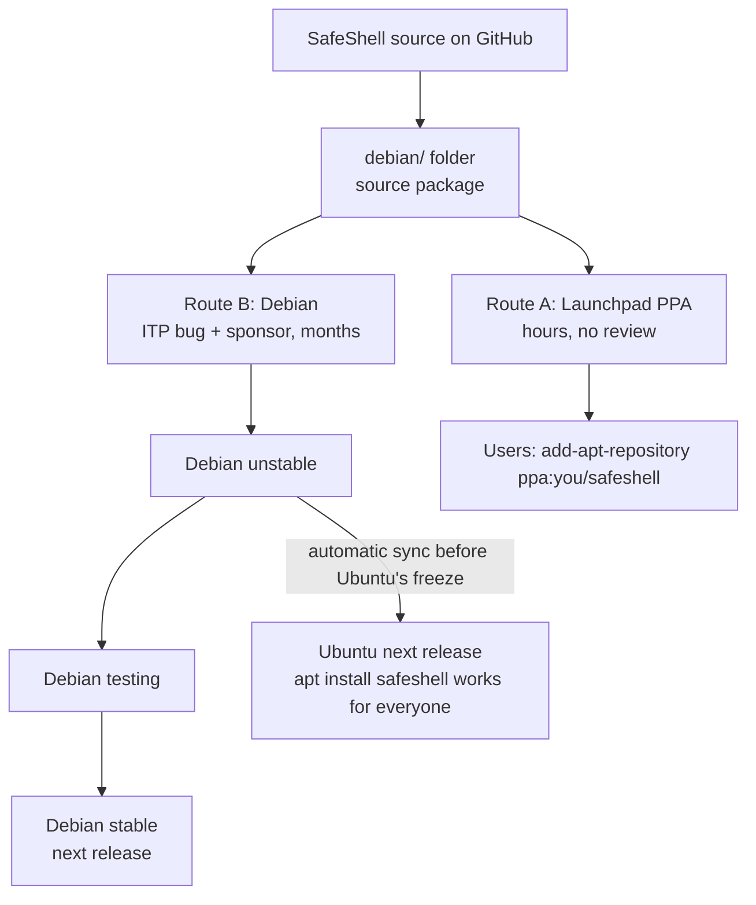
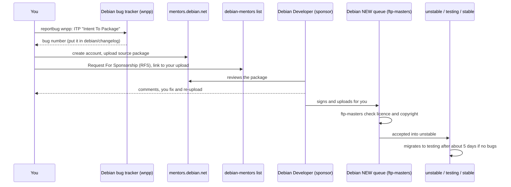

# Getting SafeShell into Debian and Ubuntu

Goal: a friend types `sudo apt install safeshell` on a fresh Ubuntu or Debian machine and it
just works, with no extra download or setup line.

`apt` only installs from repositories it already knows. Ubuntu and Debian ship their own
archives, so SafeShell has to be **accepted into them**. This document covers the three ways,
from fastest to most official.



| Route | Who can use it | Time | Effort | Result |
|---|---|---|---|---|
| A. Launchpad PPA | Ubuntu users who add your PPA first | 1 to 2 hours | low | `add-apt-repository` + `apt install` |
| B. Debian archive | everyone on Debian, and (via sync) Ubuntu | 2 to 6 months | high | plain `apt install safeshell` |
| C. Ubuntu directly | everyone on Ubuntu | slower than B | highest | normally not needed: use B |

Both A and B start from the same thing: a **Debian source package**.

## Step 0: things to decide first

1. **Licence.** Done: the repo is MIT ([LICENSE](../LICENSE)), which Debian accepts.
2. **Go import path.** The module is named `safeshell`. Debian's Go tooling wants a full path such as
   `github.com/samarthsinh2660/safeshell`. Either rename the module (a one-line change in `go.mod`
   plus every import) or set `XS-Go-Import-Path` in `debian/control`. Renaming is cleaner.
3. **Dependencies.** The module uses `mvdan.cc/sh/v3`, `golang.org/x/sys`, and `golang.org/x/term`.
   Debian builds with its own packaged copies (`golang-mvdan-sh-dev`, `golang-golang-x-sys-dev`,
   `golang-golang-x-term-dev`). Check `rmadison golang-mvdan-sh-dev` and that the packaged versions
   are new enough, or the build will fail in Debian's clean build environment.
4. **Go version.** `go.mod` asks for a very new Go. Debian's `golang-any` may be older. Check with
   `rmadison golang-go`. If it is too old, lower the `go` line to what the code really needs.
5. **No network at build time.** Debian builds are offline. Nothing may download during `go build`.
6. **The AI download.** `ss ai setup` fetches a llama.cpp engine and a model when the *user* asks.
   That is acceptable for a package (nothing is downloaded at install time) but reviewers will ask
   about it. Keep it opt-in, and say so in `debian/README.Debian`.

## Step 1: write the `debian/` folder

Install the tools: `sudo apt install devscripts debhelper dh-make-golang dh-golang sbuild lintian reportbug`.

`dh-make-golang` can generate a first draft for you:

```bash
dh-make-golang make github.com/samarthsinh2660/safeshell
```

Whatever way you start, you end with these files in `debian/`:

```
debian/
  control        package name, description, build dependencies, runtime dependencies
  changelog      version history; first entry is "Initial release (Closes: #ITP-bug-number)"
  copyright      machine-readable licence list: SafeShell (MIT) plus each dependency
  rules          tiny makefile: "%:\n\tdh $@ --builddirectory=_build --buildsystem=golang --with=golang"
  compat / or    use debhelper-compat (= 13) in Build-Depends instead of a compat file
  source/format  "3.0 (quilt)"
  install        usr/bin/ss, and the AppArmor profile into etc/apparmor.d
  postinst       reload the AppArmor profile (already written: safeshell/packaging/deb/postinst)
  watch          how Debian finds new upstream releases on GitHub
```

A minimal `debian/control`:

```
Source: safeshell
Section: utils
Priority: optional
Maintainer: Your Name <you@example.com>
Build-Depends: debhelper-compat (= 13), dh-golang, golang-any,
 golang-mvdan-sh-dev, golang-golang-x-sys-dev, golang-golang-x-term-dev
Standards-Version: 4.7.0
Homepage: https://github.com/samarthsinh2660/safeshell
XS-Go-Import-Path: github.com/samarthsinh2660/safeshell
Rules-Requires-Root: no

Package: safeshell
Architecture: any
Depends: ${misc:Depends}, ${shlibs:Depends}
Description: safety layer for your terminal
 Rates every command by how reversible it is, shows what it would do in a
 sandbox, blocks dangerous ones, and lets you undo. Optional built-in AI.
```

Use your real name and a real email you read: Debian maintainers are reachable people.

## Step 2: build and check it properly

```bash
# in a clean, offline build environment, exactly like Debian's build servers
sbuild -d unstable
# static checks; fix every E: error and read every W: warning
lintian -i -I --pedantic ../safeshell_*.changes
# actually install it in a throwaway container and try it
```

The package must build with no network, install cleanly, remove cleanly (`apt remove`,
`apt purge` leave nothing behind), and `lintian` should report no errors.

## Route A: Launchpad PPA (fastest)

A PPA is your own small apt repository hosted by Ubuntu's Launchpad. Launchpad builds your
source package on its servers, signs the result, and hosts it.

1. Create an account at <https://launchpad.net>. Create a GPG key (`gpg --full-generate-key`), upload
   its fingerprint to Launchpad, and confirm the email Launchpad sends. (Launchpad's own signing of
   the built packages is automatic; your key only signs the *upload*.)
2. On your Launchpad page choose **Create a new PPA**, e.g. `safeshell`.
3. In `debian/changelog` use an Ubuntu series, e.g. `safeshell (0.1.0-1~ppa1) noble; urgency=medium`.
4. Build the signed source package and upload it:
   ```bash
   debuild -S -sa
   dput ppa:<launchpad-user>/safeshell ../safeshell_0.1.0-1~ppa1_source.changes
   ```
5. Launchpad emails you when it accepts and builds it. Then users run:
   ```bash
   sudo add-apt-repository ppa:<launchpad-user>/safeshell
   sudo apt install safeshell
   ```

Trade-off: users must add the PPA once, and each Ubuntu release needs its own upload.

## Route B: the Debian archive (the real `apt install safeshell`)



1. **ITP.** Run `reportbug wnpp` and choose "ITP". Title: `ITP: safeshell -- safety layer for your terminal`.
   This announces you are packaging it and prevents duplicate work. Note the bug number.
2. **Mentors account.** Register at <https://mentors.debian.net>, add your GPG key. Upload:
   ```bash
   dput mentors ../safeshell_0.1.0-1_source.changes
   ```
3. **Ask for a sponsor (RFS).** You are not a Debian Developer yet, so someone who is must upload for you. Send
   an email to `debian-mentors@lists.debian.org` titled `RFS: safeshell/0.1.0-1 [ITP]` with the
   mentors.debian.net link, what the program does, and the ITP bug number. You can also ask on the
   `#debian-mentors` IRC channel.
4. **Review.** A sponsor reads the package and replies with changes. Fix, bump to `-2`, upload again. This
   loop is normal and teaches you the Debian rules.
5. **Upload and NEW.** The sponsor uploads. A new package waits in the NEW queue while the archive
   team checks licences. It can take days to a few weeks.
6. **Maintain.** After acceptance you (or your sponsor) answer bug reports and upload new versions. The
   `debian/watch` file lets Debian tools notice your new GitHub releases.

Useful links: [Debian New Maintainers' Guide](https://www.debian.org/doc/manuals/maint-guide/),
[Debian Go packaging team](https://go-team.pages.debian.net/packaging.html),
[Debian Policy](https://www.debian.org/doc/debian-policy/), <https://mentors.debian.net/intro-maintainers/>.

## Route C: Ubuntu

Ubuntu does not need a separate submission in the normal case.

- **Automatic sync from Debian.** Once SafeShell is in Debian *unstable*, Ubuntu's tooling copies it into
  the next development release before the "Debian Import Freeze". That Ubuntu release then has it in
  `universe`, and `sudo apt install safeshell` works with no extra steps. Older Ubuntu releases do not get it.
- **Request a sync by hand.** If a release is already frozen, file a "Sync request" bug on Launchpad
  (`requestsync safeshell`) so a member of the Ubuntu archive team approves it.
- **Direct upload (rarely needed).** A new Ubuntu-only package goes through the Ubuntu Developer process
  (<https://wiki.ubuntu.com/UbuntuDevelopment/NewPackages>), needs an Ubuntu sponsor from the MOTU team, and is a lot more work than
  getting into Debian first. Use it only if Debian refuses the package.

## Recommended plan for SafeShell

1. Rename the Go module to the full GitHub path and check the dependency and Go versions (Step 0).
2. Create `debian/`, build with `sbuild`, get `lintian` clean.
3. Publish to a **PPA** first. Friends on Ubuntu can use it the same day.
4. File the **ITP**, upload to mentors, ask for a sponsor. This gives plain `apt install safeshell` in the
   next Ubuntu and Debian releases.
5. Until then, the `.deb` on [GitHub Releases](https://github.com/samarthsinh2660/safeshell/releases)
   works with `sudo apt install ./safeshell_X.Y.Z_amd64.deb`.
